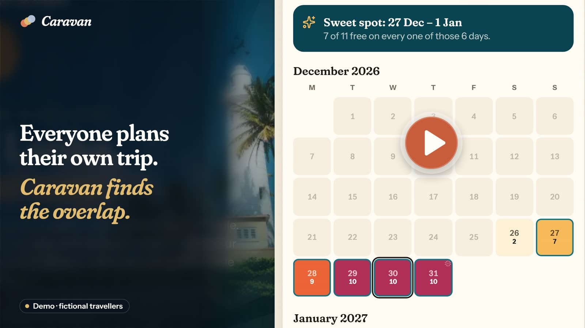
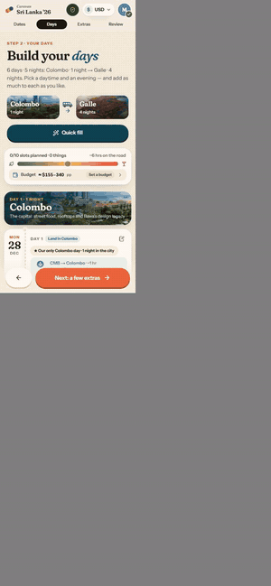
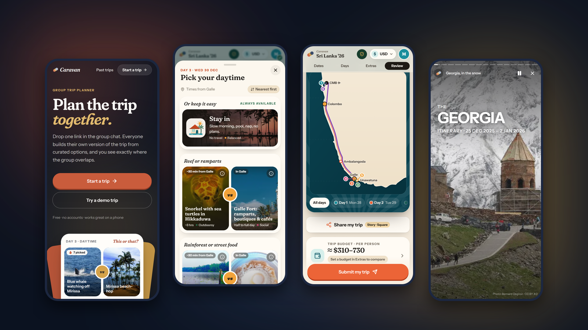
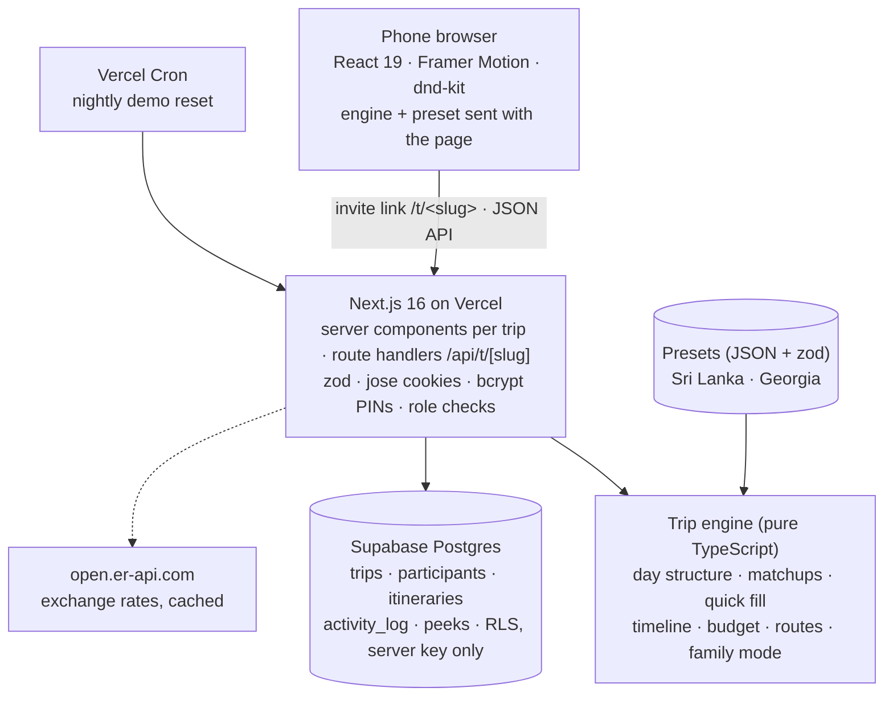

# Caravan

**Plan the trip together.** A group-trip planner where everyone builds their own version of the trip from curated options — and the organizer sees exactly where the group overlaps.

[](https://github.com/abdulaz06/caravan/actions/workflows/ci.yml)

<p align="center">
  <a href="https://www.youtube.com/watch?v=K-CRkvDnjPc" title="Watch the Caravan demo">
    
  </a>
</p>
<p align="center">
  <a href="https://www.youtube.com/watch?v=K-CRkvDnjPc"><strong>▶ Watch the 1-minute demo</strong></a>
</p>

**Live:** [caravan-prod.vercel.app](https://caravan-prod.vercel.app) · **📖 Case study:** [/case-study](https://caravan-prod.vercel.app/case-study) · **Try a demo trip:** [/demo](https://caravan-prod.vercel.app/demo) · **A past trip, as a story:** [/past/georgia-2025/story](https://caravan-prod.vercel.app/past/georgia-2025/story)

---

## Why

Group chats are where trip plans go to die: nobody commits, the loudest voice wins, and twelve calendars never line up. Caravan began as an app for one real trip — 13 friends, Sri Lanka over New Year — where **8 people submitted a full plan within a week**. It's now a planner for any group and any destination.

## How it works



1. **Start a trip** at `/new`: pick a destination, name the trip, choose a name and a 4-digit PIN. You get one invite link.
2. **Everyone builds their own version.** Friends open the link (no accounts), drag a date window onto the calendar, and fill each day and evening — starting from a this-or-that matchup between two real, photographed options, with a catalog for more.
3. **See the overlap.** A date heatmap with the sweet spot, the most-picked options, everyone on one nature ↔ nightlife line, roommate matches, and JSON/CSV exports for planning the final itinerary.

▶ **[Watch the 1-minute demo on YouTube](https://www.youtube.com/watch?v=K-CRkvDnjPc)** · **[Phone walkthrough — 60 s](docs/media/demo.mp4)**

<br clear="right" />

## Features



- **Matchups and a catalog** — curated A-vs-B pairs per slot, then “+ Add another”, reordering, drive times between stops, soft time totals and day-of-week availability.
- **Two speeds** — a five-minute quick fill, or hand-pick every slot and add notes.
- **Group view** — date heatmap, 🔥 popular picks (counts, never who), a group spectrum, and a 👀 *peek* at friends' drafts that never shows private answers.
- **Budget** in 10 currencies with live exchange rates, per person and line by line.
- **Organizer console** per trip — owner and admin roles checked on the server, live trip rules (lock edits, nights per base, date window, browsing), announcements, content controls, an activity log and exports.
- **Share images** — 9:16 and square posters with the route map, drawn on a canvas so they work on iPhone Safari.
- **Family-friendly mode** — one switch swaps every nightlife pick for a wholesome alternative, view-only, guaranteed by a word-list check at validation.
- **Demo trips** — one per destination with 12 fictional travellers; try one as a guest or open the console read-only. Rebuilt every night.
- **Past trips** — real trips, anonymised, as tap-through stories plus the full timeline and route map.

## Architecture



- **Destinations are data.** Everything that makes a trip *that* trip lives in a **preset**: `presets/<id>/preset.json` plus credited photos. The engine reads only the preset and the trip's live rules, so Sri Lanka (tropical, Colombo → Galle by van) and Georgia (alpine, a Tbilisi base with rental cars) run on the same code and look nothing alike.
- **The engine is pure and explicit.** Every function takes an `Engine` (`{ catalog, rules, plans }`) instead of reading globals — so two trips render side by side on the server, and the browser runs the same code from the preset the page sent.
- **The server owns the data.** Supabase is reached only from server code with the service key; every table has RLS on and no policies. Each trip is isolated: people, plans, rules and logs belong to one invite link, and every organizer endpoint re-checks the role.
- **Plans are versioned.** Itineraries carry a `version`; migrations are idempotent and keep every pick they can, and a field an older client doesn't send means “unchanged”.

### A preset, in short

```jsonc
{
  "id": "georgia",
  "destination": { "country": "Georgia", "headline": ["Georgia,", "in the snow."], "season": "Dec 2026 – Jan 2027", ... },
  "currency": { "local": "GEL", "default": "USD" },
  "structure": { "bases": [{ "id": "tbilisi", "nights": { "default": 8, "min": 3, "max": 12 }, ... }], "transfers": [], ... },
  "regions":   [{ "id": "gudauri", "lat": 42.4775, "lng": 44.4797, ... }],
  "travel":    { "known": [["tbilisi", "gudauri", 2.5]], "vehicle": "rental car", "selfDrive": true, ... },
  "map":       { "projection": { "xScale": 0.74, ... }, "outline": [...], "surroundings": "...", ... },
  "activities": [{ "id": "gudauri-ski", "kind": "option", "slots": ["day"], "vibe": -2, "sources": [...], ... }],
  "pairs":     [{ "id": "ski-or-fly", "slot": "day", "a": "gudauri-ski", "b": "gudauri-paragliding" }],
  "specialDates": [{ "id": "nye", "date": "12-31", "pairs": { "tbilisi": "nye-tbilisi" }, ... }],
  "theme": { "palette": { ... }, "fonts": { "display": "playfair", "body": "instrument" }, "illustrations": "alpine" }
}
```

Every field, and how to add a destination: [`docs/PRESETS.md`](docs/PRESETS.md). `npm run preset:validate` checks the schema, every cross-reference, photos on disk and family mode's banned words.

## Stack

Next.js 16 (App Router) · React 19 · TypeScript · Tailwind CSS v4 · Framer Motion · dnd-kit · zod · Supabase Postgres · jose · bcryptjs · Vitest · Playwright · Vercel (+ Cron).

## Run it locally

```bash
npm install
npm run dev:local        # http://localhost:3100, on a local JSON test database (.data/)
```

No database needed: without Supabase settings (or with `CARAVAN_LOCAL_STORE=1`) the app uses a local store. Start a trip at `/new`, or open `/demo`.

## Deploy

Supabase (one SQL migration) + Vercel (environment variables and a cron for the demo): step by step in [`SETUP.md`](SETUP.md).

## Tests

```bash
npm run typecheck        # tsc
npm run lint             # eslint
npm test                 # unit tests (Vitest): engine, presets, trip creation limits, demo seeding, past trips
npm run preset:validate  # every preset
npm run e2e              # Playwright: iPhone 14, iPhone SE and desktop, on a throwaway local store
npm run build
```

[GitHub Actions](.github/workflows/ci.yml) runs all of them on every push. `node scripts/record-demo.mjs` re-records the phone walkthrough, GIF, hero and case-study screenshots; `node scripts/record-desktop.mjs` the 16:9 desktop walkthrough (both need a local server and ffmpeg). `node scripts/record-linkedin.mjs` films the one-minute LinkedIn cut at a true 60 fps and 2560×1440 into `out/linkedin/` (gitignored): headless Chromium on a virtual clock renders every frame at its exact time, so it doesn't depend on the screen it runs on.

## Project layout

```
presets/<id>/          destination presets: preset.json, photos.json, images/
content/               past trips and case-study numbers
src/engine/            the trip engine (pure TypeScript) and the preset schema
src/lib/server/        store (Supabase or local), sessions, trips, demo, exports
src/app/               pages and API routes: /, /new, /t/[slug]/…, /demo, /past, /case-study
src/components/        UI: caravan/ (landing, new trip, case study), trip/, group/, admin/, past/
scripts/               dev server, photo pipeline, map outlines, brand assets, demo recording
tests/unit, tests/e2e  Vitest and Playwright
```

## Credits

Photos by Wikimedia Commons contributors, credited on every option and slide. Map outlines from [Natural Earth](https://www.naturalearthdata.com/) (public domain). Designed and built by Abdul.
