# The group plan — how Caravan turns everyone's plans into one trip

Each traveller builds their own version of the trip. The **consensus
generator** turns all of them into one suggested group trip that an
organizer can tweak and publish. It is:

- **Deterministic** — no AI or LLM calls, no randomness. The same inputs (in
  any order) always give the same plan; every tie is broken the same way.
- **Explainable** — every placed item carries reasons ("9 of 12 picked this",
  "Fridays only — fits Fri 1 Jan", "Added to lift someone who'd otherwise get
  little of what they picked") and its runner-up (the best option not placed
  anywhere in the plan). Every traveller's missed picks get a count-based
  reason ("Only 2 others picked it"). When fairness couldn't lift anyone, the
  plan says why in plain words.
- **Inside the rules** — it never places anything the trip itself wouldn't
  allow (pools, special dates, weekday-only options, big day trips…), and it
  adds its own realism rules (one main meal a slot, extras close by…).
- **Self-contained** — pure functions in [`src/engine/consensus/`](../src/engine/consensus)
  that take the trip's `Engine` explicitly. The server adapter
  ([`src/lib/server/plan.ts`](../src/lib/server/plan.ts)) only loads ballots,
  strips private data and stores versions, so the engine can be ported to
  another app as-is.

| File | What it does |
|---|---|
| `dates.ts` | Scoring every date window; each length's best window; the recommended length |
| `generate.ts` | Votes, slots and their rules, the most popular plan, the fairness lift, improvement, extras, splits, reasons, satisfaction |
| `compare.ts` | Every decision mode on the same inputs, summarised side by side |
| `settings.ts` | The organizer's knobs, validated (zod) |
| `types.ts` | The plan format (JSON-safe; stored as-is in a plan version) |

## The pipeline

```mermaid
flowchart LR
  plans["Everyone's plans<br/>dates + picks"] --> votes["1 · Equal voice<br/>normalised votes<br/>stay-ins = rest demand"]
  votes --> dates["2 · Dates<br/>length vs attendance,<br/>best window"]
  dates --> slots["3 · Slots<br/>the window's day structure,<br/>the trip's rules + realism"]
  slots --> A["A · Most popular plan<br/>fill, improve, extras<br/>(= Majority rules)"]
  A --> B["B · Lift the lowest share<br/>leximin, within a tolerance"]
  B --> C["C · Improve<br/>never lowering the lowest share"]
  C --> out["Splits, reasons,<br/>satisfaction"]
  out --> pub["Publish → RSVPs"]
```



## 1. Votes with equal voice

Every traveller with a plan (draft or submitted; never test users or demo
guests) is a **voter** with a weight:

```
W_b = 1                      if their plan is submitted
W_b = draftWeight (0.5)      if it's a draft         (organizer knob, 0–1)
```

A voter's **units** are their distinct activity picks plus each stay-in
they chose: `n_b = |picks_b| + stays_b`. Each unit is worth

```
u_b = W_b / n_b
```

so **every traveller's total say is the same** however many things they
picked. Support for item *i* on day *d* only counts the people who are
**there that day** (inside their own dates):

```
S(i, d) = n̄ · Σ_{b picked i, b there on d} u_b          (n̄ = mean n_b, so S ≈ people)
```

Headcounts ("9 of 12 picked this") are shown alongside; when a winner had
fewer raw pickers than its runner-up, the chip says why (equal voice, who's
there that day, lifting someone, or fit).

**Stay-in** is demand for rest. A voter who stayed in on 3 of their 10
evenings wants about 30 % of the plan's evenings free: `want_b,t =
round(stays_b,t / slots_b,t × slots_t)` (at least 1 if they picked any). The
k-th rest slot of a type is worth the voice of the people there who wanted
at least k — diminishing, so rest is balanced rather than piled up.

Day-trip **variants** (a sunrise summit vs an easy morning) are decided by
the variant most of the item's present pickers chose.

## 2. Dates: length vs attendance, then the window

A longer trip is more trip, but fewer people can come for all of it. So the
length isn't the median of what people picked — it's a trade-off, worked out
for **every allowed length** `L` (the trip's rules, default 1–14 days):

1. Score every window of `L` days inside the trip's dates (below) and keep
   the best one.
2. Note how many travellers are free for **all** of it (`full_L`) and its
   person-days.

The **recommended length** maximises

```
full_L × L          (people there for every day × days)
```

among lengths of at least the preset's suggested minimum (`dates.recommended.min`,
e.g. 5 for Sri Lanka, 7 for Georgia) — so a 2-day trip everyone can make
never beats a real trip. Ties go to more people there for all of it, then
more person-days, then the shorter trip. If nobody is free for a whole trip
of any eligible length, the preset's suggested length is used.

Organizers see this as a compact table in the console — *5 days: 8 of 11 can
do it all · 6 days: 6 · 7 days: 4*, each with its best window — and can **use
any length** or **pin any window**. With **Fixed trip length** on, the length
is fixed and only the window is chosen (no table).

Windows of the chosen length are scored, best first, by:

1. how many travellers are free for **the whole window**,
2. total **person-days** (Σ days each traveller is there),
3. the fewest people **missing more than one day**,
4. the earliest start (a stable tie-break).

The best window is chosen; up to three **runners-up** (each starting at least
two days from the others) show who'd miss which days — names for organizers
only.

## 3. Slots and the hard rules

The chosen window gets the trip's normal day structure (arrival, transfer
days, bases, fly-home — see [PRESETS.md](PRESETS.md)). Each slot (day ×
Daytime/Evening) can only hold what the trip's own validation allows —
`itemAllowed` from the itinerary engine plus:

| Rule | How |
|---|---|
| Pools | an option sits only in a slot of one of its areas (unless the organizers turned base filtering off) |
| Transfer days | the daytime is the route's "on the way" pool; rest there means "straight there" |
| **Transfer evenings** | only items of the **base you've just arrived at** (Sri Lanka's road-day pub golf is the Galle one), even with base filtering off |
| **Landing day** | stays close: within the extra radius of the base or the airport |
| Fly-home day | no slots; a 1-day trip has a daytime only |
| Special dates | the slot (e.g. 31 Dec's evening) holds the special pair's **most-voted** option, pinned to its date; nothing else as its main item; never split |
| Weekdays | `availableDays` options only on those weekdays |
| Big day trips | only on a base's ordinary days and only ever as the day's main item (`big day trip` tag, `variants` or `onlyBaseDays`); their tied extras (`onlyWith`) only alongside them |
| **One main meal a slot** | at most one item tagged `meal` (dinners, food crawls, cooking classes, long lunches) per slot; a nightlife pick whose family-friendly stand-in is a meal counts as one, so family view never shows two dinners either. Small food extras stay untagged and can join a meal. |
| **Extras close by** | an extra is within the preset's `structure.extraRadiusHours` (default 45 min one way) of the slot's main item — or of the base, when the main item is close to the base too. Out on a day trip (or anything beyond the radius) extras are near the trip, never back at base. A half-day trip like Uplistsikhe is never an extra. |
| **Variety in a slot** | two items of the same main category in one slot only when at least half of those there picked one of them |
| Time | a slot's items plus the drive out, between them and back fit the preset's limit; on landing and road days that drive comes out of the daytime |
| Early starts | no late-night item the evening before a variant with an early start |
| No duplicates | an activity appears once in the whole plan (stay-in can repeat) |
| Hidden | options the organizers hid are never placed |

**Soft costs** (in tenths of the group, `P = ΣW / 10`) steer without
forbidding:

| Cost | Size |
|---|---|
| Travel each way beyond 45 min | `0.8·P` per hour |
| A packed slot (over the preset's time limit, not a variant day trip) | `3·P` |
| A far evening on a transfer day (> 1 h) | `2·P` |
| Diving the day before flying | `5·P` |
| A big night before an early or big-day-trip start | `2·P` |
| Same region as yesterday's same slot / same main category / two big day trips in a row | `variety · (2 · 0.5 · 3)·P` |
| Cost above the group's per-slot budget (`ref`) | `budgetFit · max(0, (mid − ref)/ref) · 2·P` |
| Rest after a big day trip / before an early start | a bonus of `1.5·P` / `1·P` |

`ref` is the median budget tier's upper bound minus the plan's
accommodation and transport, spread over its slots.

## 4. Fairness by share

A traveller's **share** is what fraction of their picks made it — out of the
picks that *could* have:

```
share_b = made_b / feasible_b
feasible_b = b's picks that could fit some slot on a day b is there (in the chosen window)
made_b     = b's picks in the plan on a day b is there
```

So someone who's only there for three days isn't "unhappy" about picks for
days they're away, and a 20-pick enthusiast and a 4-pick minimalist are
measured on the same scale.

**A · The most popular plan first.** Fill every slot by score — repeatedly
place the (slot, item) pair with the highest `S − penalties` (stay-in valued
by the rest demand above) — then improve it by local search with no fairness
term, then add **popular extras** (picked by ≥ 30 % of those there, at least
2) where there's time, up to two per slot. This is exactly what *Majority
rules* produces, and its score is the **yardstick**:

```
score = Σ S(item) over every main item and extra  +  rest value  −  Σ penalties
```

**B · Lift the lowest share (leximin).** Take the traveller with the lowest
share (ties: id) and look at every way to add one of their picks:

- add it as an **extra** to a slot on a day they're there (if it fits the
  time, the radius and the slot's other rules — this costs no popularity);
- put it **instead of** a slot's main item;
- **move** it from a day they're away to a day they're there (a swap of
  two main items).

A move is allowed only if it lifts them, **nobody ends below
min(their old share, the lifted share)** — so the sorted shares rise in
leximin order — and the plan keeps

```
score ≥ popularScore − tolerance · |popularScore|          (tolerance default 15%)
```

The cheapest allowed move (least score lost) wins; then it starts again from
whoever is lowest now. When the lowest person can't be lifted, they're set
aside and the next lowest is tried — raise the lowest, then the next lowest.
Up to 400 lifts, deterministic order.

**C · Improve, guarded.** Steepest ascent over two moves — *replace* a slot's
main item with another candidate (or rest) and *swap* two slots' items — on

```
F = score  +  λ · 8 · Σ_b W_b · ln(0.1 + share_b)
```

The last term is **proportional fairness**: a pick for someone with little
counts far more than one more for someone with most of theirs. A move is
never allowed to break a hard rule, move a locked/special item, lower the
**minimum share** Phase B reached, or drop the score below the tolerance
floor. Up to 80 rounds, deterministic order.

**When it can't lift anyone**, the plan says why, in plain words (shown in
the console and in compare modes):

- *the tolerance* — "Lifting whoever gets the smallest share would cost more
  than the 15% of popularity this mode may give up — allow more in Knobs";
- *someone else* — "…would push someone else even lower, so the most popular
  plan is already the fairest";
- *nothing fits* — "Whoever gets the smallest share has no other picks that
  fit the days they're there".

Adding an extra adds support, so a lifted plan can score a little *higher*
than the most popular one: Majority rules only adds extras ≥ 30 % of those
there picked, to keep days unhurried, while a lift adds one for a person who
needs it.

## The three decision modes

There is **no default**: the first time an organizer generates, they choose.

| Mode | Strength | λ | May give up | In plain words |
|---|---|---|---|---|
| **Everyone gets a say** | 1 | 0.5 | `tolerance` (15 %) | Lifts whoever would get the smallest share of their picks — then the next lowest — giving up a little of the plan's popularity to do it. Then the rest goes to whatever's most popular. |
| **Majority rules** | 0 | 0 | 0 | The most-picked option wins every slot. Simple and popular — but someone with unusual taste might get very little. |
| **Custom** (slider t ∈ [0, 1]) | t | 0.5·t | t · `tolerance` | Slide between the two: t = 0 is Majority rules exactly, t = 1 is Everyone gets a say exactly. |

The **compare modes** view runs all three on the same inputs (same dates,
locks and splits) and shows each one's lowest and median share, Jain's index,
picks placed, people left with none, the score kept and slots that differ.
When every mode makes the same plan, it says why (the note above). Travellers
see "Planned with: Everyone gets a say. Whoever would have got the smallest
share of their picks was lifted first, then the rest went to the most
popular. Everyone got at least 40% of the picks that fit their dates." — a
count, never who.

**A 13-person, fixed 6-day, two-base trip** (the original group's shape) uses
exactly these numbers: there's no `K` to work out any more. *Everyone gets a
say* may give up 15 % of the most popular plan's score, *Custom* at the
slider's halfway 7.5 %, *Majority rules* nothing; the lift works on shares,
whatever the group's size or length. [CONSENSUS-DEMO.md](CONSENSUS-DEMO.md)
runs that shape.

## Splits

A slot gets a **split suggestion** when its main item A and another feasible
option B both have **strong, mostly separate** supporters among those there:

- both camps `≥ max(3, ⌈splitShare × those there⌉)` — `splitShare` is an
  organizer knob, default **40 %** (each camp at least 2 in 5 of the people
  there that day);
- `|A ∩ B| ≤ ⅓ · min(|A|, |B|)`;
- never on arrival, transfer or fly-home days, or a special date;
- each option is suggested as B once — on the day its camp is biggest (then the earliest).

It shows headcounts ("4 want the flea market / 4 want skiing"). The default
is together; an organizer **accepts** (both stay in the slot, both camps
count as satisfied, B is reserved) or **rejects** it per slot. Suggested
splits are found before extras, so the second camp's pick isn't squeezed in
alongside.

## Satisfaction and the fairness metric

For each traveller: their **share** (above) — shown with names to organizers
("6/9"), and to each traveller as *Your picks made it* (their own only, "60 %
of the 10 that fit your dates", with a reason for each miss). Across the
group (everyone with a say and a pick that could fit):

- **lowest** and **median** share,
- **Jain's fairness index** `J = (Σx)² / (n · Σx²)` — 1.00 when everyone did
  equally well, `1/n` when one person got everything,
- versus Majority rules: the lowest share before and after, how many were
  lifted, and the share of the most popular plan's score kept.

## Organizer knobs

All stored with the trip's rules (`rules.plan`, validated field by field —
knobs from before this version, like the old guaranteed-picks count, are
simply ignored); the demo keeps them in the visitor's browser and never saves.

| Knob | Range | Default |
|---|---|---|
| Decision mode | together · majority · custom | *none — chosen on first generate* |
| Custom slider (Majority rules ↔ Everyone gets a say) | 0–1 | 0.5 |
| Popularity it may give up (`tolerance`) | 0–50 % | 15 % |
| Suggest splitting up (`splitShare`) | 15–75 % of those there | 40 % |
| Draft weight | 0–1 | 0.5 |
| Variety | 0–1 | 0.5 |
| Budget fit | 0–1 | 0 |
| Length / pinned window | any allowed length (the trade-off table) · any window inside the dates | auto |
| Locks | an item on a date & slot (a swap is a lock) | — |
| Splits | accepted / rejected per slot | together |

Locks and accepted splits are placed first and survive every regenerate; a
lock that no longer fits (new dates, a rule change) is dropped with a note.

## Complexity

With `V` voters, `D` days, `s ≤ 2D` slots, `c` candidates per slot (options
someone picked that the slot could hold) and `p` picks per voter:

- votes `O(V · p)`; dates `O(L · W · V)` for `L` allowed lengths and `W`
  windows each;
- Phase A: fill `O(s² · c)`, improvement `O(R · (s·c + s²) · V)` for `R ≤ 80`
  rounds;
- Phase B: each lift tries `O(p · s)` moves, each evaluated on the slots
  around it, for at most 400 lifts;
- Phase C as Phase A's improvement.

In practice: **30 travellers × 14 days ≈ 0.5 s** (a unit test asserts
< 1 s); the demo crews (11 × 5–8 days) take about 0.15 s per mode.
[CONSENSUS-DEMO.md](CONSENSUS-DEMO.md) shows every mode on both demo crews
(`npx tsx --conditions=react-server scripts/consensus-report.ts`).

## Publishing, RSVPs and privacy

- Organizers **save versions** and **publish** one; travellers see the
  latest published version at `/t/<slug>/plan`, with the plain-words line
  above, the dates, timeline, map and budget estimate, share images and a
  print view. Versions saved before shares existed still show (without the
  share line).
- Every item has a stable key (`date:slot:id` hashed), so after a new
  version **RSVPs are kept on unchanged items** and a "Plan updated" notice
  says how many things are new or moved.
- **Counts only, never who**: the traveller view is stripped on the server
  (no `pickedBy`, lift attributions, split camps, names on RSVPs or dates).
  Organizers see names in the console. Demo guests and test users never
  count, except to themselves.

## Tests

[`tests/unit/consensus.test.ts`](../tests/unit/consensus.test.ts) covers
equal voice, draft weight, rest demand, determinism (any ballot order), the
length trade-off and its recommendation, **property-style checks** across
random groups, every length from 1 to 14, all three modes and several presets
and rule sets — every hard rule above (meals, transfer evenings, landing day,
extras' radius, variety in a slot) and that fairness never leaves the lowest
share below Majority rules' — the tolerance (never exceeded; more tolerance
lifts at least as far), Custom at 0 and 1, the demo crews' modes differing,
the road-day pub golf, split detection, the threshold knob and acceptance,
the NYE pin, weekday rules, locks surviving regeneration, short-trip
structures and performance. [`tests/unit/plan-server.test.ts`](../tests/unit/plan-server.test.ts)
covers publishing, privacy, RSVP counting and plans published before shares;
[`tests/e2e/group-plan.spec.ts`](../tests/e2e/group-plan.spec.ts) the console
(compare modes, the length table, the split knob), meals on both demos and the
demo loading straight away when its seed is stale.
