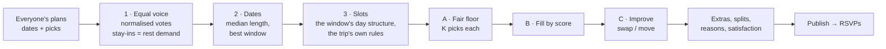

# The group plan — how Caravan turns everyone's plans into one trip

Each traveller builds their own version of the trip. The **consensus
generator** turns all of them into one suggested group trip that an
organizer can tweak and publish. It is:

- **Deterministic** — no AI or LLM calls, no randomness. The same inputs (in
  any order) always give the same plan; every tie is broken the same way.
- **Explainable** — every placed item carries reasons ("9 of 12 picked this",
  "Fridays only — fits Fri 1 Jan", "Added so everyone gets some of their
  picks" — shown only where the floor beat a better-supported option) and its
  runner-up (the best option not placed anywhere in the plan). Every traveller's missed picks get a
  count-based reason ("Only 2 others picked it").
- **Inside the rules** — it never places anything the trip itself wouldn't
  allow (pools, special dates, weekday-only options, big day trips…).
- **Self-contained** — pure functions in [`src/engine/consensus/`](../src/engine/consensus)
  that take the trip's `Engine` explicitly. The server adapter
  ([`src/lib/server/plan.ts`](../src/lib/server/plan.ts)) only loads ballots,
  strips private data and stores versions, so the engine can be ported to
  another app (Lanks) as-is.

| File | What it does |
|---|---|
| `dates.ts` | The typical length and scoring every date window |
| `generate.ts` | Votes, slots, fair floor, fill, improvement, extras, splits, reasons, satisfaction |
| `compare.ts` | Every decision mode on the same inputs, summarised side by side |
| `settings.ts` | The organizer's knobs, validated (zod) |
| `types.ts` | The plan format (JSON-safe; stored as-is in a plan version) |

## The pipeline



## 1. Votes with equal voice

Every traveller with a plan (draft or submitted; never test users or demo
guests) is a **voter** with a weight:

```
W_b = 1                      if their plan is submitted
W_b = draftWeight (0.5)      if it's a draft         (organizer knob, 0–1)
```

A voter's **units** are their distinct activity picks plus each stay-in
they chose: `n_b = |picks_b| + stays_b`. Each unit is worth

```
u_b = W_b / n_b
```

so **every traveller's total say is the same** however many things they
picked. Support for item *i* on day *d* only counts the people who are
**there that day** (inside their own dates):

```
S(i, d) = n̄ · Σ_{b picked i, b there on d} u_b          (n̄ = mean n_b, so S ≈ people)
```

Headcounts ("9 of 12 picked this") are shown alongside; when a winner had
fewer raw pickers than its runner-up, the chip says why (equal voice, who's
there that day, the fair floor, or fit).

**Stay-in** is demand for rest. A voter who stayed in on 3 of their 10
evenings wants about 30 % of the plan's evenings free: `want_b,t =
round(stays_b,t / slots_b,t × slots_t)` (at least 1 if they picked any). The
k-th rest slot of a type is worth the voice of the people there who wanted
at least k — diminishing, so rest is balanced rather than piled up.

Day-trip **variants** (a sunrise summit vs an easy morning) are decided by
the variant most of the item's present pickers chose.

## 2. Dates and length

- **Length** = the (lower) median length of the submitted plans — or of all
  plans if none is submitted, or the suggested length if nobody has dates.
  With "Fixed trip length" on it's the fixed length; organizers can pin
  another (knob).
- Every window of that length inside the trip's dates is scored, best first,
  by:
  1. how many travellers are free for **the whole window**,
  2. total **person-days** (Σ days each traveller is there),
  3. the fewest people **missing more than one day**,
  4. the earliest start (a stable tie-break).
- The best window is chosen; up to three **runners-up** (each starting at least
  two days from the others) show who'd miss which days — names for
  organizers only. Organizers can pin any window.

## 3. Slots and the hard rules

The chosen window gets the trip's normal day structure (arrival, transfer
days, bases, fly-home — see [PRESETS.md](PRESETS.md)). Each slot (day ×
Daytime/Evening) can only hold what the trip's own validation allows —
`itemAllowed` from the itinerary engine plus:

| Rule | How |
|---|---|
| Pools | an option sits only in a slot of one of its areas (unless the organizers turned base filtering off) |
| Transfer days | the daytime is the route's "on the way" pool; rest there means "straight there" |
| Fly-home day | no slots; a 1-day trip has a daytime only |
| Special dates | the slot (e.g. 31 Dec's evening) holds the special pair's **most-voted** option, pinned to its date; nothing else as its main item; never split |
| Weekdays | `availableDays` options only on those weekdays |
| Big day trips | only on a base's ordinary days; their tied extras (`onlyWith`) only alongside them |
| Early starts | no late-night item the evening before a variant with an early start |
| No duplicates | an activity appears once in the whole plan (stay-in can repeat) |
| Hidden | options the organizers hid are never placed |

**Soft costs** (in tenths of the group, `P = ΣW / 10`) steer without
forbidding:

| Cost | Size |
|---|---|
| Travel each way beyond 45 min | `0.8·P` per hour |
| A packed slot (over the preset's time limit, not a variant day trip) | `3·P` |
| A far evening on a transfer day (> 1 h) | `2·P` |
| Diving the day before flying | `5·P` |
| A big night before an early or big-day-trip start | `2·P` |
| Same region as yesterday's same slot / same main category / two big day trips in a row | `variety · (2 · 0.5 · 3)·P` |
| Cost above the group's per-slot budget (`ref`) | `budgetFit · max(0, (mid − ref)/ref) · 2·P` |
| Rest after a big day trip / before an early start | a bonus of `1.5·P` / `1·P` |

`ref` is the median budget tier's upper bound minus the plan's
accommodation and transport, spread over its slots.

## 4. Fair floor, fill, improve

**Phase A — the fair floor.** Each voter should get at least **K** of their
picks (on days they're there). Repeatedly take the **least-satisfied**
traveller still below K (ties: whoever has the fewest options left, then
id) and place their best feasible pick:

```
value(i, s) = S(i, d_s) − pen(i, s) − ½·max(0, best_s − S(i, d_s)) − 5P · reliance(s)
```

The third term avoids taking a slot from something much more popular; the
fourth avoids taking a slot that other people still short of the floor
depend on. People with nothing feasible are skipped (and counted).

`K` adapts to the trip: `K = clamp(round(1.5 · slots / voters), 1, 3)`;
organizers can set 0–5.

**Phase B — fill by score.** Until every slot is filled, take the
(slot, item) pair with the highest `S − penalties` (stay-in valued by the
rest demand above) and place it.

**Phase C — local improvement.** Steepest ascent over two moves — *replace*
a slot's main item with another candidate (or rest) and *swap* two slots'
items — on

```
F = Σ S  +  rest value  −  Σ penalties  +  λ · 8 · Σ_b W_b · ln(0.1 + made_b / cap_b)
```

where `made_b` is how many of b's picks are in the plan on days they're
there and `cap_b = min(picks_b, slots b is there for)`. The last term is
**proportional fairness**: a pick for someone with little counts far more
than one more for someone with most of theirs. A move is never allowed to
break a hard rule, move a locked/special item, or push anyone below the
floor Phase A reached. Up to 80 rounds, deterministic order.

**Two starts.** Placing floor picks first can steer local search into a worse optimum than filling by popularity would have. So the generator runs twice — floor first (A → B → C) and fill first (B → C) — and keeps the fill-first plan only if it gives everyone at least what the floor-first run did *and* scores higher on `F`. Both runs are deterministic, so the choice is too.

**Extras.** Popular add-ons (picked by ≥ 30 % of those there, at least 2)
join slots with time to spare, up to two per slot; a big day trip's tied
extras ride along.

## The three decision modes

There is **no default**: the first time an organizer generates, they choose.

| Mode | Floor K | λ | In plain words |
|---|---|---|---|
| **Everyone gets a say** | auto | 0.4 | Everyone is guaranteed a few of their own picks first; then the rest goes to what's most popular. |
| **Majority rules** | 0 | 0 | The most-picked option wins every slot. |
| **Custom** (slider t ∈ [0, 1]) | `round(2t · auto)` (≥ 1 when t > 0) | t | Slide from pure popularity (t = 0, the same as Majority) to fairness first. |

When nobody falls below the floor, *Everyone gets a say* and *Majority rules*
make the same plan — the floor is a guarantee, not a redistribution. The
**compare modes** view runs all three on the same inputs (same dates, locks
and splits) and shows each one's lowest and median satisfaction, fairness
index, picks placed, people left with none and slots that differ.

## Splits

A slot gets a **split suggestion** when its main item A and another feasible
option B both have **strong, mostly separate** supporters among those there:

- `|A| ≥ 3`, `|B| ≥ max(3, ⌈25 % of those there⌉, ⌈|A| / 2⌉)`
- `|A ∩ B| ≤ ⅓ · min(|A|, |B|)`
- never on arrival, transfer or fly-home days, or a special date;
- each option is suggested as B once — on the day its camp is biggest (then the earliest).

It shows headcounts ("5 want diving / 8 want whale watching"). The default
is together; an organizer **accepts** (both stay in the slot, both camps
count as satisfied, B is reserved) or **rejects** it per slot. Suggested
splits are found before extras, so the second camp's pick isn't squeezed in
alongside.

## Satisfaction and the fairness metric

For each traveller: `made / min(picks, what could fit their days)` — shown
with names to organizers ("6/9"), and to each traveller as *Your picks made
it* (their own only, with a reason for each miss). Across the group:

- **lowest** and **median** satisfaction,
- **Jain's fairness index** `J = (Σx)² / (n · Σx²)` — 1.00 when everyone did
  equally well, `1/n` when one person got everything,
- how many met the floor (of those who could).

## Organizer knobs

All stored with the trip's rules (`rules.plan`, validated field by field);
the demo keeps them in the visitor's browser and never saves.

| Knob | Range | Default |
|---|---|---|
| Decision mode | together · majority · custom | *none — chosen on first generate* |
| Custom slider (popularity ↔ fairness) | 0–1 | 0.5 |
| Draft weight | 0–1 | 0.5 |
| Guaranteed picks (K) | auto · 0–5 | auto |
| Variety | 0–1 | 0.5 |
| Budget fit | 0–1 | 0 |
| Pinned window / length | any window inside the dates · 1–30 days | auto |
| Locks | an item on a date & slot (a swap is a lock) | — |
| Splits | accepted / rejected per slot | together |

Locks and accepted splits are placed first and survive every regenerate; a
lock that no longer fits (new dates, a rule change) is dropped with a note.

## Complexity

With `V` voters, `D` days, `s ≤ 2D` slots and `c` candidates per slot
(options someone picked that the slot's pool allows):

- votes `O(V · picks)`; dates `O(W · V)` for `W` candidate windows;
- Phase A `O(V · K · picks · s)`; Phase B `O(s² · c)`;
- Phase C `O(R · (s·c + s²) · (V + 1))` for `R ≤ 80` rounds (each move is
  evaluated incrementally: only the slots around it, the voters who picked
  the items involved, and rest totals when a stay-in moves).

Everything above runs twice (the two starts). In practice: **30 travellers ×
14 days ≈ 0.3 s** (a unit test asserts < 1 s); the demo crews (11 × 7–9 days)
take well under 0.1 s. [CONSENSUS-DEMO.md](CONSENSUS-DEMO.md) shows every
mode on both demo crews (`npx tsx scripts/consensus-report.ts`).

## Publishing, RSVPs and privacy

- Organizers **save versions** and **publish** one; travellers see the
  latest published version at `/t/<slug>/plan`, with a plain-words line
  ("Planned with: Everyone gets a say. Each person was guaranteed some of
  their picks before the rest went to the most popular."), the dates,
  timeline, map and budget estimate, share images and a print view.
- Every item has a stable key (`date:slot:id` hashed), so after a new
  version **RSVPs are kept on unchanged items** and a "Plan updated" notice
  says how many things are new or moved.
- **Counts only, never who**: the traveller view is stripped on the server
  (no `pickedBy`, floor attributions, split camps, names on RSVPs or
  dates). Organizers see names in the console. Demo guests and test users
  never count, except to themselves.

## Tests

[`tests/unit/consensus.test.ts`](../tests/unit/consensus.test.ts) covers
equal voice, draft weight, rest demand, determinism (any ballot order),
**property-style hard-rule checks** across random groups and every length
from 1 to 14 on three presets and several rule sets, the fair floor and a
raised floor, all three modes, split detection and acceptance, the NYE pin,
weekday rules, locks surviving regeneration, short-trip structures and
performance. [`tests/unit/plan-server.test.ts`](../tests/unit/plan-server.test.ts)
covers publishing, privacy and RSVP counting.
